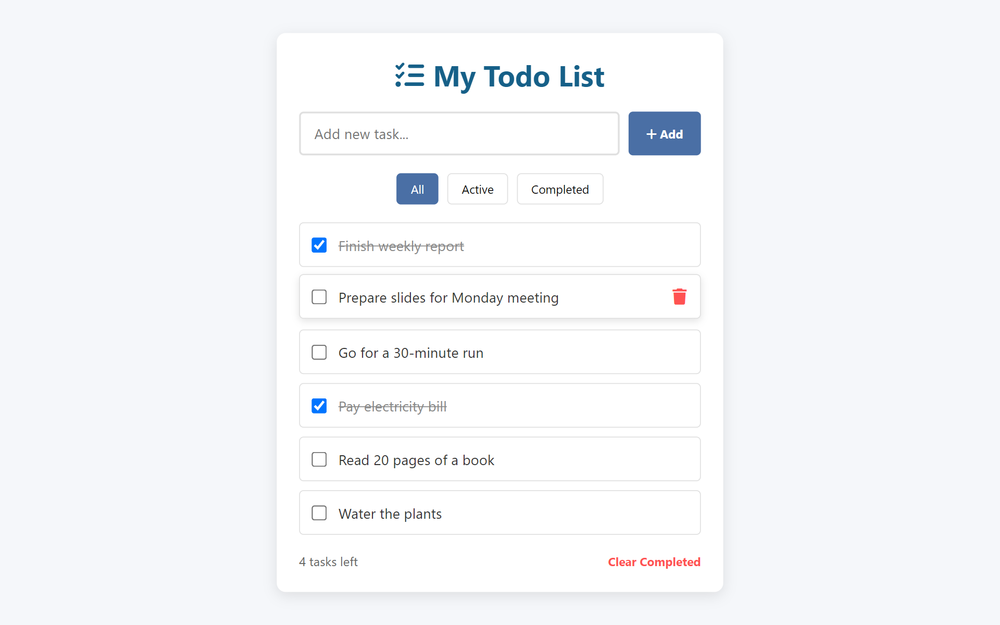
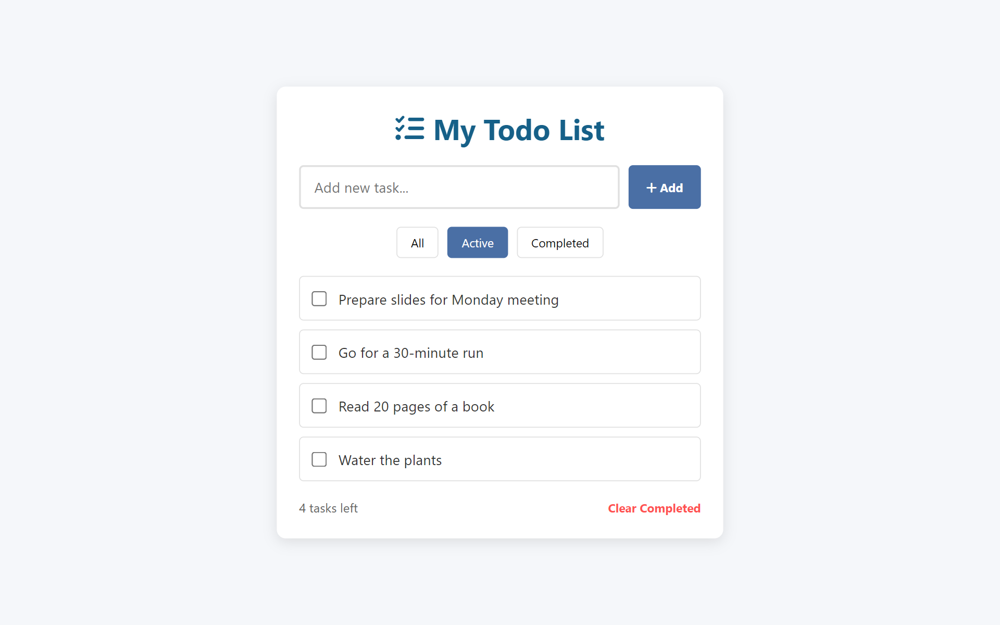
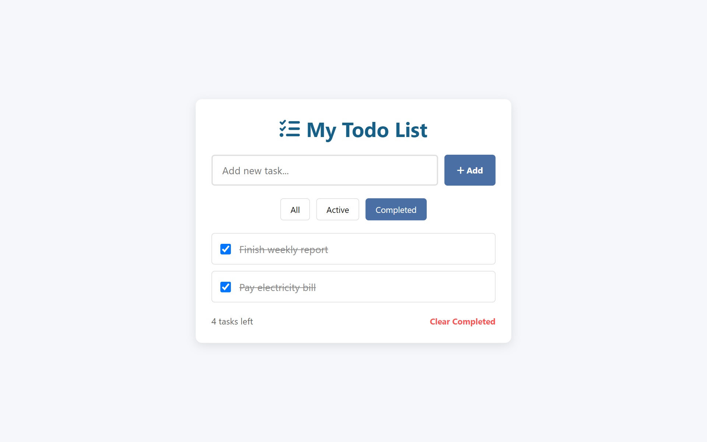
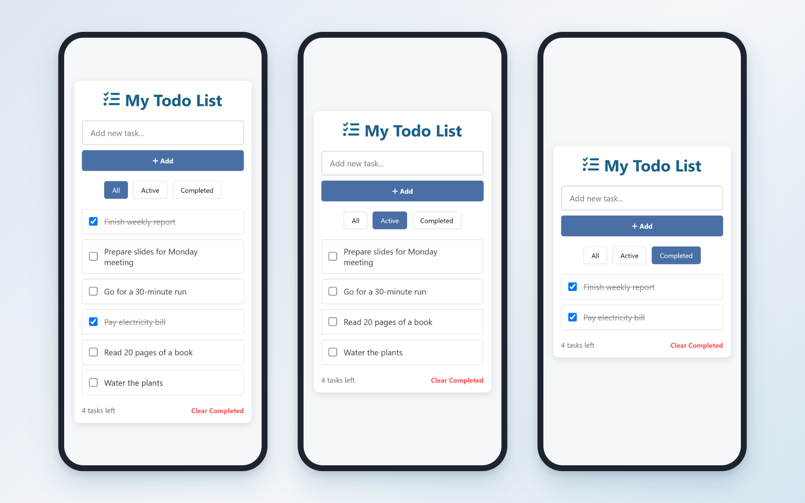
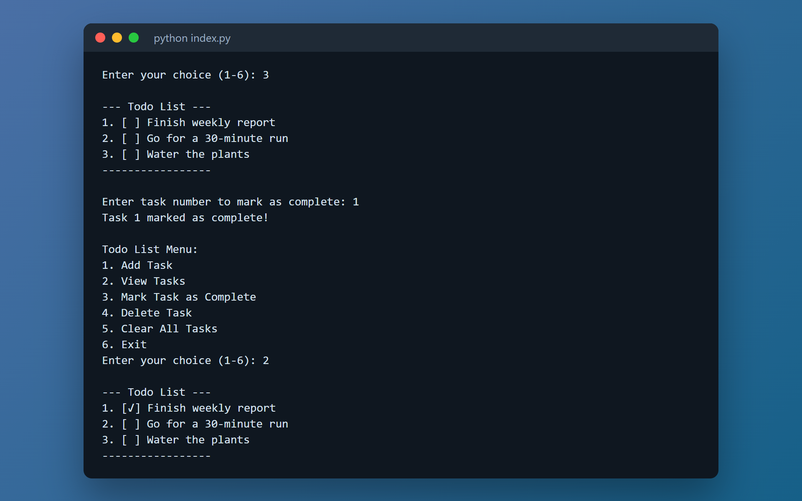

# TaskFlow

Aplikasi daftar tugas sederhana yang berjalan langsung di browser. Tambahkan tugas, tandai sebagai selesai, dan saring daftar sesuai statusnya. Aplikasi web tidak memerlukan proses build atau instalasi dependensi.

**Demo:** <https://willyrafaelfs.github.io/TaskFlow/> (cadangan di GitLab Pages: <https://taskflow-669df7.gitlab.io/>)



> Antarmuka aplikasi berbahasa Inggris dengan judul "My Todo List", jadi nama TaskFlow tidak muncul di tampilan.

## Fitur

- Menambahkan dan menghapus tugas.
- Menandai tugas sebagai selesai atau belum selesai.
- Menyaring daftar untuk melihat semua, tugas aktif, atau tugas selesai.
- Menampilkan jumlah tugas yang tersisa.
- Menghapus semua tugas yang sudah selesai.
- Menyimpan tugas di `localStorage` browser.
- Menyesuaikan tampilan untuk layar HP (di bawah 480px, input dan tombol Add menjadi bertumpuk).

## Tangkapan layar

| Filter Active | Filter Completed |
| --- | --- |
|  |  |

Tampilan HP (filter All, Active, dan Completed):



Versi terminal Python:



> Tangkapan layar memakai tugas contoh, bukan data asli.

## Cara kerja

- Tanpa framework, build, maupun dependensi: hanya tiga berkas statis (`index.html`, `styles.css`, `script.js`).
- Satu fungsi render menggambar ulang daftar sesuai filter aktif dan memperbarui penghitung tugas tersisa.
- Event delegation pada daftar tugas: satu listener menangani centang dan hapus untuk semua item, termasuk item yang baru ditambahkan.
- Versi terminal Python memakai kelas `TodoList` dengan menu tambah, lihat, tandai selesai, hapus, dan hapus semua dengan konfirmasi.
- Setiap push ke branch utama di GitLab otomatis di-deploy ke GitLab Pages lewat GitLab CI.

## Teknologi

- HTML, CSS (custom properties, Flexbox, media query)
- JavaScript vanilla dan `localStorage`
- Font Awesome 6 (CDN)
- Python 3
- GitLab CI/CD, GitLab Pages, dan GitHub Pages

## Menjalankan secara lokal

### Aplikasi web

Persyaratan: Python 3 untuk menjalankan server web lokal. Tidak ada dependensi proyek yang perlu dipasang.

Klon repositori dari GitHub atau GitLab, lalu masuk ke folder proyek:

```bash
git clone https://github.com/willyrafaelfs/TaskFlow.git
cd TaskFlow
```

Atau gunakan GitLab:

```bash
git clone https://gitlab.com/willyrafaelfs/TaskFlow.git
cd TaskFlow
```

Jalankan server lokal:

```bash
python -m http.server 8000
```

Buka <http://localhost:8000> di browser. Hentikan server dengan `Ctrl+C` di terminal.

> Ikon menggunakan Font Awesome dari CDN, sehingga memerlukan koneksi internet.

### Aplikasi terminal Python

Repositori ini juga menyertakan versi daftar tugas berbasis terminal:

```bash
python index.py
```

Versi terminal berjalan terpisah dari aplikasi web dan tidak menggunakan daftar tugas yang sama. Tugas di versi terminal tidak disimpan dan hilang saat program ditutup.

## Penyimpanan data

Daftar tugas disimpan di `localStorage`. Data hanya tersedia pada browser dan perangkat tempat tugas dibuat; data tidak tersinkron ke perangkat lain. Menghapus data situs dari browser juga dapat menghapus daftar tugas.

## Struktur berkas

| Berkas | Keterangan |
| --- | --- |
| `index.html` | Struktur halaman aplikasi web |
| `styles.css` | Gaya dan tata letak |
| `script.js` | Interaksi aplikasi dan penyimpanan tugas di browser |
| `index.py` | Versi aplikasi daftar tugas berbasis terminal |
| `docs/screenshots/` | Tangkapan layar untuk README |
